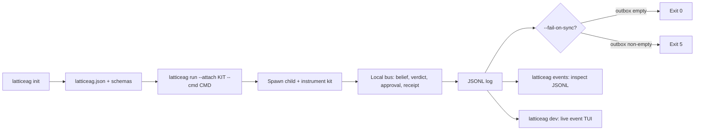

# LatticeAG latticeag-cli 🧰

<p align="center">
  <a href="https://github.com/LatticeAG/latticeag-cli/blob/main/LICENSE">
    
  </a>
  <a href="https://github.com/LatticeAG/latticeag-cli/actions/workflows/ci.yml">
    
  </a>
  <a href="https://github.com/LatticeAG/latticeag-cli/stargazers">
    
  </a>
  <a href="https://github.com/LatticeAG/latticeag-cli/issues">
    
  </a>
  <a href="https://github.com/LatticeAG/latticeag-cli">
    
  </a>
  <a href="https://nodejs.org/">
    
  </a>
</p>

<p align="center">
  <b>The LatticeAG stack as one command. Every product event, one schema.</b><br/>
  Install, wire, and run LatticeAG products as one local system.
</p>

<p align="center">
  <a href="#quick-start">Quick Start</a> ·
  <a href="#why-latticeag-cli">Why latticeag-cli</a> ·
  <a href="#how-it-works">How It Works</a> ·
  <a href="#features">Features</a> ·
  <a href="#configuration">Configuration</a> ·
  <a href="#file-tree">File Tree</a>
</p>

---

`latticeag` installs, wires, and runs LatticeAG products as one local system. Beliefs, diffs, verdicts, approvals, and receipts share a single versioned event model (`@latticeag/events`, currently `0.1.0`).

Built by [LatticeAG](https://github.com/LatticeAG).

## Why latticeag-cli

- **One command for the whole stack** - scaffold, attach, execute, and observe every LatticeAG product without learning each repo's bespoke wiring.
- **One event schema** - beliefs, tool observations, verdicts, approvals, and receipts all validate against `@latticeag/events`. The `runs-on-latticeag` example asserts the chain order `belief < verdict < approval < receipt`.
- **Adapter-gated products** - the `products` catalog lists 19 products across the poly, lex, vek, axi, vis, and forge series with live adapter status (`available` vs `stub`).
- **Offline-first** - the local bus, JSONL log, fixture beliefs/approvals, and the reference demo run with no cloud dependency.
- **Machine-friendly** - `--json` puts machine JSON on stdout with diagnostics on stderr; `--quiet` silences everything but errors.

### How latticeag-cli is different

- **Not a launcher script** - `latticeag run` attaches a real instrumentation kit (`openai-completions`, `openai-agents`, `hermes`, `langgraph`, `custom`) to a spawned command, streams product events to a JSONL log, and can fail the build (`--fail-on-sync`) when the sync outbox is non-empty.
- **Schema-versioned events, not log lines** - `codegen` regenerates types from the events package; `VERSIONING.md` governs the event contract.
- **Live TUI included** - `latticeag dev` runs with a live event TUI (`@latticeag/events-tui`) instead of tailing a file.

## Quick Start

Two caveats up front: **14 of the 19 catalog products run `@latticeag/adapter-stub`** until their live adapters land, and **the hosted LexGateway relay is invite-only** — everything in this quick start runs locally with no keys.

```bash
# 1. Prerequisites: Node >= 20.19, pnpm 9.15.0
node --version   # >= 20.19
pnpm --version   # 9.15.0

# 2. Install and build — in that order. The `latticeag` bin is a thin
#    checked-in launcher (packages/cli/bin/latticeag.js) that delegates to
#    dist/cli.js: `pnpm install` links it on the first pass, and it runs
#    once `pnpm build` has produced dist (no re-install needed).
git clone https://github.com/LatticeAG/latticeag-cli.git
cd latticeag-cli
pnpm install
pnpm build

# 3. Install the bin globally — or skip this and substitute
#    `node packages/cli/bin/latticeag.js` (run from the repo root) for
#    `latticeag` below; `pnpm exec latticeag` also works inside any
#    workspace package that depends on @latticeag/cli (e.g. examples/*).
pnpm add -g @latticeag/cli

# 4. Scaffold a project and check setup
latticeag init ./my-project   # writes latticeag.json, .env.example, src/agent.ts stub
cd my-project
cp .env.example .env          # stub keys for live products — see below
latticeag doctor              # rows: node, config, events, adapters, env_*, health
latticeag products            # 19 products, adapter status per row (wired/available/stub)
```

Init quirks the smoke test surfaced: `init` enables the `axion`, `visreplay`, `lexverdict`, and `vekinbox` adapters, so `doctor` reports `fail env_*` rows until the matching `.env` keys are set (`AXION_*`, `LEXVERDICT_URL`, `VEKINBOX_*`) — those are only needed for live products, not the offline path below. Re-running `init` where `latticeag.json` already exists requires `--force`. `init --template demo` copies the `runs-on-latticeag` example (needs the repo checkout, not a global install); the scaffolded project runs the offline fixture with no `npm install` — its `@latticeag/cli` dep is dropped since the bin comes from PATH — and only needs `pnpm install` for live mode (`openai`) or the vitest suite.

Verify with the offline reference demo (no API keys, no adapter env vars):

```bash
cd examples/runs-on-latticeag
LATTICEAG_GOAL="Write production config.yaml with env: production and replicas: 3" \
VEKINBOX_AUTO_APPROVE=1 \
pnpm exec latticeag run \
  --fixture-beliefs fixtures/beliefs.json \
  --fixture-approvals fixtures/approvals.json \
  --attach custom \
  --cmd "npx tsx src/agent.ts --offline-fixture"

npx tsx src/assert-chain.ts .latticeag/events.jsonl
# order ok: belief=1 < verdict=3 < approval=4 < receipt=5
pnpm exec latticeag events --type verdict   # inspect the JSONL log
```

`--fixture-beliefs` / `--fixture-approvals` (or the `LATTICEAG_FIXTURE_*` env vars) mark an offline run: Axion emits beliefs from the fixture file, VekInbox loads fixture approvals/receipts, and LexVerdict skips the `LEXVERDICT_URL` requirement. A live `run` still hard-fails (exit 4) when a required adapter env var is absent — a silent no-verify run would be a false pass.

The `.env.example` stub keys and what they gate: `OPENAI_API_KEY`/`ANTHROPIC_API_KEY` (live attach kits), `AXION_*` (live Axion webhook), `LEXVERDICT_URL` (live verify endpoint), `VEKINBOX_*` + `VEKINBOX_AUTO_APPROVE` (live approvals API / fixture auto-approve), `LEXGATEWAY_*` (invite-only relay sync), `LATTICEAG_GOAL` (the goal LexVerdict verifies against).

## How It Works



## Features

### Core Commands

| Command | Description |
|---------|-------------|
| `latticeag init [dir]` | Scaffold a project (writes `latticeag.json` + wiring). |
| `latticeag run --cmd ... --attach KIT` | Attach an instrumentation kit and execute. Kits: `openai-completions` (default), `openai-agents`, `hermes`, `langgraph`, `custom`. |
| `latticeag dev` | Run with a live event TUI. |
| `latticeag events` | Inspect the JSONL event log. |
| `latticeag doctor` | Check node version, config presence/validity, events package, adapters, and env keys. |
| `latticeag products` | List the 19-product catalog with per-product adapter status. |
| `latticeag version` | Print CLI semver and workspace package versions. |

### Execution Options

| Feature | Description |
|---------|-------------|
| **Attach kits** | `--attach openai-completions\|openai-agents\|hermes\|langgraph\|custom`. |
| **Adapter overlays** | `--adapters <list>` as a temporary overlay; cannot enable an adapter absent from config. |
| **Timeouts** | `--timeout-ms <n>`; `0` means no timeout, otherwise SIGTERM at n, SIGKILL at n+5000. |
| **Resume** | `--run-id <ulid>` reuses a run id for resume of the JSONL only. |
| **Offline fixtures** | `--fixture-beliefs` (Axion adapter) and `--fixture-approvals` (VekInbox adapter) read fixtures instead of the network. |
| **Sync gate** | `--fail-on-sync` exits 5 if the sync outbox remains non-empty. |
| **Global flags** | `--config <path>`, `--cwd <dir>`, `--json`, `--quiet`, `--verbose`, `--no-color` (also honors `NO_COLOR`). |

### Packages

| Package | Version | Description |
|---------|---------|-------------|
| `@latticeag/cli` | 0.1.2 | The `latticeag` binary. |
| `@latticeag/events` | 0.1.0 | The single versioned event model + codegen. |
| `@latticeag/config` | 0.1.1 | Config discovery, validation (`latticeag-config-v1` schema). |
| `@latticeag/bus` | 0.1.0 | Local event bus. |
| `@latticeag/core` | 0.1.0 | Shared core logic. |
| `@latticeag/events-tui` | 0.1.0 | Live event TUI for `latticeag dev`. |
| `@latticeag/adapter-axion` | 0.1.0 | Axion adapter (`available`). |
| `@latticeag/adapter-lexverdict` | 0.1.0 | LexVerdict adapter (`available`). |
| `@latticeag/adapter-vekinbox` | 0.1.0 | VekInbox adapter (`available`). |
| `@latticeag/adapter-viscompile` | 0.1.0 | VisCompile adapter (`available`). |
| `@latticeag/adapter-visreplay` | 0.1.0 | VisReplay adapter (`available`). |
| `@latticeag/adapter-stub` | 0.1.0 | Placeholder for products without a live adapter. |

## Configuration

`latticeag init` scaffolds a `latticeag.json` validated against `schemas/latticeag-config-v1.schema.json`. Config discovery walks up from `--cwd` (or cwd); `--config <path>` overrides via `LATTICEAG_CONFIG`.

```bash
latticeag init ./my-project
latticeag --cwd ./my-project doctor
latticeag --config ./my-project/latticeag.json products
```

`latticeag doctor` reports per-check rows (verified live):

```
pass  node_version        24.19.0
fail  config_present      not found     # until you run init
pass  events_package      0.1.0
warn  env_OPENAI_API_KEY  absent        # only needed for live kits
```

`latticeag run` also reads `--env-file <path>` via dotenv without overriding existing env vars. Hosted LexGateway relay is invite-only; everything else listed above runs locally.

## Verification

```bash
pnpm build       # pnpm -r build
pnpm test        # pnpm -r test (vitest across all packages + offline example)
pnpm typecheck   # pnpm -r exec tsc --noEmit
pnpm --filter @latticeag/events codegen
```

The `@latticeag/events` codegen — including the codegen drift test and the
python `models.py` artifacts — needs a repo-root Python venv with
`datamodel-code-generator`, `pydantic`, `pytest`, and `hatchling` (the same
venv CI creates):

```bash
python3 -m venv .venv
.venv/bin/pip install 'datamodel-code-generator>=0.26' 'pydantic>=2.10,<3' pytest hatchling
```

Without it the codegen drift test is skipped rather than failing; the
`codegen` command itself still requires the venv. The remaining test files
run with Node alone.

Test suite (verified): **177 passed, 0 failed across 42 test files and 13 packages** — including the offline end-to-end `runs-on-latticeag` fixture (`belief → verdict → approval → receipt` chain order asserted).

## File Tree

```
packages/
  cli/            latticeag binary (init, run, dev, events, doctor, products)
  events/         versioned event model + codegen + VERSIONING.md
  config/         config discovery + latticeag-config-v1 validation
  bus/            local event bus
  core/           shared core logic
  tui/            live event TUI (@latticeag/events-tui)
  adapters/       axion, lexverdict, vekinbox, viscompile, visreplay, stub
schemas/
  latticeag-config-v1.schema.json
examples/
  runs-on-latticeag/   offline fixture: run then assert-chain
pnpm-workspace.yaml
```

## Known Issues

- **Adapters are mostly stubs** - of 19 catalog products, 5 adapters report `available`; the rest run against `@latticeag/adapter-stub` until their live adapters land.
- **Hosted LexGateway relay is invite-only** - OSS covers the CLI, events schema, adapters, local bus, and reference demo.
- **Generated runtime state is gitignored** - `**/.latticeag/` and python caches are ignored; example runs recreate them.

## License

MIT — see [LICENSE](./LICENSE).
